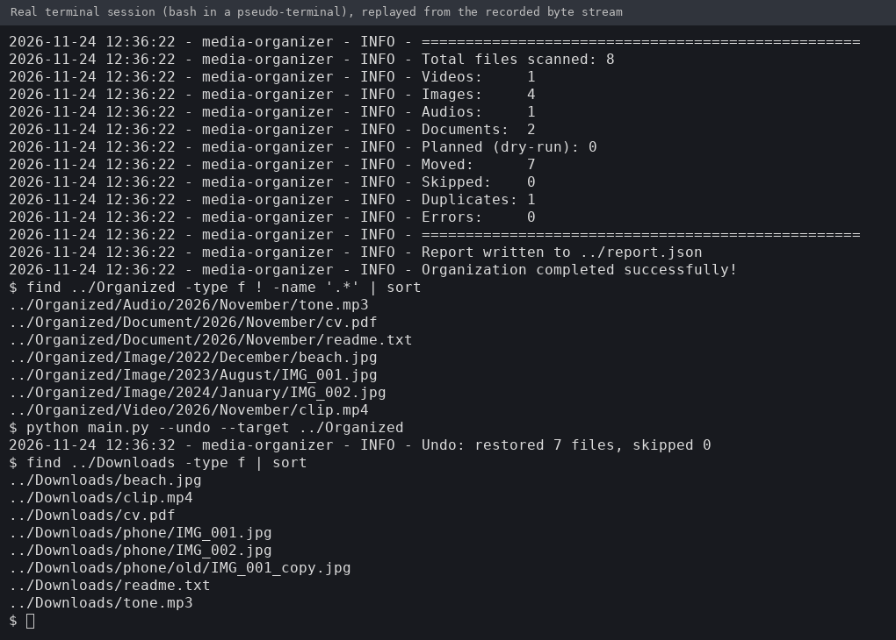

# Media Organizer Pro

<div align="center">


**Command-line tool that sorts media files into Type/Year/Month folders.**

Automatically organizes your video, image, and audio files into structured folders by file type and modified date, reading metadata with FFmpeg and Pillow. There is no machine learning in it yet.

[🚀 Demo](#-demo) • [📖 Installation](#-installation) • [⚙️ Configuration](#-configuration) • [🤝 Contributing](#-contributing)

</div>

---

## 🎯 Features

| Feature | Description |
|---------|-------------|
| 🎬 **Video Analysis** | Extract metadata (resolution, duration, codec, FPS) using FFmpeg |
| 🎵 **Audio Processing** | Analyze bitrate, sample rate, channels, and quality |
| 🖼️ **Image Analysis** | Detect resolution, megapixels, and animated GIFs (needs Pillow) |
| ⚙️ **Configurable** | YAML-based configuration for custom workflows |
| 🔍 **Dry-Run Mode** | Preview changes before applying them |
| 📊 **Statistics** | Detailed reporting of organization results |
| 🔄 **Recursive Search** | Organize entire directory trees (always on for now, no switch to turn it off) |

---

## 📸 Demo



_Image: a frame from a real terminal session (dry run, real run, listing, undo) on a sample folder with generated files. The session ran in a pseudo-terminal; the video replays its recorded output in a terminal-style window, because no terminal emulator was available to film. Video: [docs/demo.mp4](docs/demo.mp4)._

**New in v2**

| Option | What it does |
|---|---|
| `--undo --target OUT` | Puts the files of the last run back where they were (last 20 runs are kept in `.media-organizer-undo.json`). Copies made with `--copy` are deleted again. |
| `--dedupe` | Skips a file whose content is identical (SHA-256) to one already in the target or seen earlier in the run. The duplicate stays in the source. |
| `--copy` | Copies instead of moving. |
| `--no-recursive` | Only the top level of the source (before, recursion could not be turned off). |
| `--folder-format FMT` | Folder layout inside the target. `{type}` and `{%Y} {%m} {%B} {%b} {%d}` only, e.g. `{type}/{%Y}/{%B}` (default), `{%Y}/{%m}/{type}`, `{type}`. Anything else (unknown placeholder, `..`, absolute path) is rejected before any file is touched. Also settable as `folder_format` in `config.yaml`. |
| `--report FILE` | JSON report: totals plus what happened to every file. |
| Photo dates | Images go into the folder of the date taken (EXIF), not the date the file was last modified. Without EXIF, the modified date is used. |

Fixed: documents were never counted in the statistics; `--dry-run` was ignored when a `--config` file was used; the shipped `config.yaml` was not valid YAML (so `--config config.yaml` always failed) and unknown keys such as `folder_format` were not accepted. Unknown settings in a config file are now an error that names them; symbolic links are ignored; a move that fails halfway no longer leaves a copy in the target; the exit code is 1 if any file failed.

Preview first with `--dry-run`: it lists where each file would go and moves nothing.

**What it does:** sorts image, video, audio and document files by type and date, reads metadata (video/audio through FFmpeg, images through Pillow), never overwrites (a name clash gets `_1`, `_2`), skips files already in the target folder, leaves unknown file types where they are.
**Not implemented:** the ML classification is a placeholder and does not change where files go. Layout is `Type/Year/Month` unless you set `--folder-format` / `folder_format`.

Tests: `python -m pytest tests` (40 tests, end-to-end runs of `main.py` on temporary folders). Safety cases covered: undo never overwrites a new file at the original path; undo keeps edits made after the move; a copy edited after `--copy` is not deleted by undo; symbolic links are ignored; a second run changes nothing; a read-only folder is reported (exit code 1), leaves no stray copy and other files still move; invalid `folder_format` and unknown config keys are rejected; the shipped `config.yaml` loads.

---

## 📦 Installation

### Prerequisites

- Python 3.9 or higher
- FFmpeg (for video/audio processing)
- Pillow (images), PyYAML (config). TensorFlow is not needed: the ML classifier is a placeholder

### Quick Install

```bash
# Clone the repository
git clone https://github.com/mahamed-yasser/media-organizer-pro.git
cd media-organizer-pro

# Install dependencies
pip install -r requirements.txt

# Optional: Install FFmpeg (if not already installed)
# Windows: choco install ffmpeg
# macOS: brew install ffmpeg
# Linux: sudo apt install ffmpeg
```

### Development Installation

```bash
# Create virtual environment
python -m venv venv
source venv/bin/activate  # On Windows: venv\Scripts\activate

# Install in development mode
pip install -e ".[dev]"

# Run tests
pytest
```

---

## ⚙️ Configuration

Create a `config.yaml` file in the project root:

```yaml
source_dir: "./Downloads"
target_dir: "./Organized"
recursive: true
dry_run: false
max_file_size_mb: 10240

video_extensions:
  - ".mp4"
  - ".avi"
  - ".mkv"
  - ".mov"

image_extensions:
  - ".jpg"
  - ".jpeg"
  - ".png"
  - ".gif"

audio_extensions:
  - ".mp3"
  - ".wav"
  - ".flac"

# Enable ML classification (requires tensorflow)
use_ml_classification: false
```

---

## 🚀 Usage

### Basic Usage

```bash
# Organize files from Downloads to Organized folder
python main.py --source ./Downloads --target ./Organized

# Recursive mode (default)
python main.py --source ./Media --recursive

# Dry-run mode (preview only)
python main.py --source ./Downloads --dry-run

# With custom configuration
python main.py --source ./Videos --config config.yaml --verbose

# Show statistics after completion
python main.py --source ./Photos --target ./Images --stats
```

### Command Line Options

| Option | Description | Default |
|--------|-------------|---------|
| `--source, -s` | Source directory | Required |
| `--target, -t` | Target directory | `./{source}_organized` |
| `--config, -c` | YAML config file | None |
| `--dry-run, -d` | Preview without moving | `False` |
| `--recursive, -r` | Search subdirectories | `True` |
| `--verbose, -v` | Enable debug logging | `False` |
| `--max-size, -m` | Max file size (MB) | `10240` |
| `--stats` | Show statistics | `False` |

---

## 📁 Project Structure

```
media-organizer-pro/
├── main.py                  # Entry point
├── src/
│   ├── __init__.py          # Package init
│   ├── organizer.py         # Main organization logic
│   ├── video_processor.py   # Video metadata extraction
│   ├── audio_processor.py   # Audio metadata extraction
│   ├── image_processor.py   # Image analysis
│   ├── classifier.py        # Placeholder classifier (no real ML)
│   ├── config.py            # Configuration management
│   └── logger.py            # Logging setup
├── tests/
│   └── test_organizer.py    # Test suite
├── config.yaml              # Example configuration
├── requirements.txt         # Python dependencies
└── README.md                # This file
```

---

## 🧪 Testing

```bash
# Run all tests
pytest

# Run with coverage
pytest --cov=src --cov-report=html

# Run specific test class
pytest tests/test_organizer.py::TestMediaType -v

# Run with verbose output
pytest -v -s
```

---

## 🤝 Contributing

Contributions are welcome! Please follow these steps:

1. Fork the repository
2. Create a feature branch (`git checkout -b feature/AmazingFeature`)
3. Commit your changes (`git commit -m 'Add AmazingFeature'`)
4. Push to the branch (`git push origin feature/AmazingFeature`)
5. Open a Pull Request

---

## 📄 License

This project is licensed under the MIT License - see the [LICENSE](LICENSE) file for details.

---

## 👨‍💻 Author

**Mahamed Yasser**
- Python Developer & Video Editor
- Qalyubia, Egypt
- [GitHub Profile](https://github.com/mahamed-yasser)

---

## 🙏 Acknowledgments

- [FFmpeg](https://ffmpeg.org/) - For powerful multimedia processing
- [Python](https://www.python.org/) - The backbone of this project
- [GitHub](https://github.com) - For hosting and collaboration

---

<div align="center">

Made with ❤️ by [Mahamed Yasser](https://github.com/mahamed-yasser)

</div>

